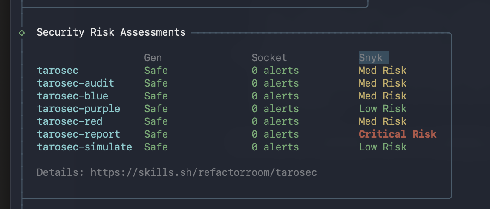

# Tarosec


**Assess. Defend. Validate. Improve.**

Tarosec is an offline cybersecurity skill suite for developers, security
reviewers, and detection engineers using AI coding agents. It helps agents turn
source code, assessment records, and telemetry into evidence-backed findings.

> **Snyk Developer Security:** Snyk may report medium- or high-severity findings
> for this suite because it contains cybersecurity tooling, security assessment
> instructions, and threat-related examples. Review each finding and its context;
> a severity rating alone does not establish whether a finding is a false positive.

## Start with `$tarosec`

Install the suite using the local checkout commands below, then enter one of
these requests in your coding agent.

- `$tarosec ./project` starts a read-only source and configuration review.
- `$tarosec blue ./logs` investigates supplied telemetry.
- `$tarosec simulate suspicious-login` generates a synthetic fixture and report.
- `$tarosec verify ./case` selects Audit or Purple based on the supplied evidence.
- `$tarosec report ./cases` consolidates supplied findings and evidence.
- `$tarosec help` lists workflows and explains any missing specialists.

The entry point checks which specialists are installed before choosing a
workflow. The existing specialists remain available for direct use.

| Skill | Use it for | Modes |
| --- | --- | --- |
| [Tarosec Audit](skills/tarosec-audit/SKILL.md) | Audit source, dependencies, CI/CD, MCP and Agent Skills | `quick`, `deep`, `dependencies`, `agents`, `verify` |
| [Tarosec Red](skills/tarosec-red/SKILL.md) | Review scope, inventory exposed assets, and triage supplied assessment results | `recon`, `scan`, `simulate`, `bounty`, `validate` |
| [Tarosec Blue](skills/tarosec-blue/SKILL.md) | Investigate supplied telemetry and design or verify detection logic | `hunt`, `triage`, `logs`, `detect`, `verify`, `monitor` |
| [Tarosec Purple](skills/tarosec-purple/SKILL.md) | Compare recorded exercise steps with expected telemetry and alerts | `plan`, `exercise`, `emulate`, `validate`, `coverage`, `retest` |
| [Tarosec Simulate](skills/tarosec-simulate/SKILL.md) | Generate controlled event records or replay sanitized evidence | `list`, `synthetic`, `replay` |
| [Tarosec Report](skills/tarosec-report/SKILL.md) | Consolidate supplied records, check evidence, and prepare reports | `summary`, `technical`, `executive`, `incident`, `coverage`, `remediation`, `compare`, `validate` |
| [Tarosec Git Issues](skills/tarosec-git-issues/SKILL.md) | Draft publication-safe GitHub issues from validated findings; publish approved creates or updates | draft, create, update |

See the [report walkthrough](examples/reporting/README.md) for standalone use.

Use the modes as cues in an agent request. The deterministic Python helpers
require Python 3.10 or later.

## Install from GitHub

Install all Tarosec skills in the current project with the [Skills CLI](https://github.com/vercel-labs/skills):

```bash
npx skills add refactorroom/tarosec
```

Select individual skills or install for specific agents:

```bash
npx skills add refactorroom/tarosec --skill tarosec --skill tarosec-simulate
npx skills add refactorroom/tarosec --skill tarosec-audit --agent codex claude-code
npx skills add refactorroom/tarosec --list
npx skills list
```

> **Note:** During installation, the Skills CLI shows a security risk table.
> Snyk rates several Tarosec skills Medium or higher, while Gen and Socket rate
> every skill clean. Tarosec is a security toolkit, so its skills describe attacks,
> scans and evidence handling, and the scanner flags that kind of content.
> See [Security scanner ratings](docs/install.md#security-scanner-ratings-during-install).
>
> 

Add `--global` when installing for your user account. After installation, start
a new agent session and request `$tarosec ./project` or `$tarosec simulate suspicious-login`.
The [Skills directory](https://skills.sh/docs/faq) discovers public skills from
installation activity.

### Install in Kilo

From the project you open in Kilo Code, Kilo CLI, or Kilo Desktop, run:

```bash
npx skills add refactorroom/tarosec --agent kilo
```

Install just the entry point and Audit skill if you only need source review:

```bash
npx skills add refactorroom/tarosec --agent kilo --skill tarosec --skill tarosec-audit
```

Add `--global` for a user-level install. Start a new Kilo session or run
`/reload`, then type `/tarosec` in the chat or ask “Use the tarosec skill to
audit this project.” Skills are loaded by Kilo separately from your model
provider settings. [Kilo skill discovery](https://kilo.ai/docs/customize/skills)

**Manual install.** Copy each whole directory from Tarosec’s `skills/` folder,
including its references and helper scripts. Keep `SKILL.md` directly inside
the skill folder. Use one of Kilo’s discovery paths:

| Scope | macOS or Linux | Windows |
| --- | --- | --- |
| Project | `.kilo/skills/<name>/SKILL.md` | `.kilo\skills\<name>\SKILL.md` |
| Global, Kilo | `~/.kilo/skills/<name>/SKILL.md` | `%USERPROFILE%\.kilo\skills\<name>\SKILL.md` |
| Global, shared across agents | `~/.agents/skills/<name>/SKILL.md` | `%USERPROFILE%\.agents\skills\<name>\SKILL.md` |

Kilo also discovers project skills in `.agents/skills/` by default. This is
where the project-level Skills CLI install places Tarosec. If a skill does not
appear after reloading, check the folder depth and confirm `SKILL.md` has
`name` and `description` in its YAML frontmatter.

**Marketplace.** For skills listed in Kilo’s catalog, open **Marketplace** in
the Kilo sidebar or **Settings → AI settings → Add** in Kilo Desktop. Select a
skill and choose **Project** or **Global** before installing. Use the GitHub
command above to install Tarosec directly. [Kilo Marketplace](https://kilo.ai/docs/customize/marketplace) · [Kilo Desktop AI settings](https://kilo.ai/docs/desktop/settings/ai)

**Custom locations.** Use `skills.paths` in `kilo.jsonc` for extra local skill
directories. Declare paths outside the project in user-level config. Use
`skills.urls` only for a hosted skill directory with an `index.json` manifest.
Each manifest entry includes a skill name and a file list containing `SKILL.md`.
An optional version tells Kilo when to refresh its cache. [Kilo custom skill paths and URLs](https://kilo.ai/docs/customize/skills#additional-skill-paths-and-remote-urls)

## Download from npm

To use the packaged skill files and Python helpers directly, install
[`tarosec@0.1.0`](https://www.npmjs.com/package/tarosec/v/0.1.0) in your project.

```bash
npm install tarosec@0.1.0
```

The published 0.1.0 package stores six skills under `node_modules/tarosec/skills/`. Use
`npx skills add refactorroom/tarosec` to register the skills with your agent.

## Install from a local checkout

Run from the project where you want to use Tarosec. Replace the source path with
the absolute path to this checkout.

```bash
npx skills@1.9.0 add /path/to/tarosec --list
npx skills@1.9.0 add /path/to/tarosec --skill '*' --agent codex claude-code --copy -y
npx skills@1.9.0 list --agent codex claude-code
```

Select a single skill with `--skill tarosec-purple`, or choose one agent with
`--agent codex` or `--agent claude-code`. These project-level commands were
checked locally with Vercel Skills 1.9.0. For a session-only Claude Code plugin,
use `claude --plugin-dir /path/to/tarosec`. See [installation and troubleshooting](docs/install.md).

## Project workspace

Answer-only assessments stay in chat. When a skill scans, tests or writes a
report, it saves everything under `.tarosec/` in the assessed project:

```text
project/
├── .gitignore          # gains "/.tarosec/workspace/"
└── .tarosec/
    ├── README.md       # explains the folder
    └── workspace/      # one directory per run, git-ignored
        ├── tarosec-audit-ab12cd/
        └── tarosec-report-ef34gh/
```

The dispatcher creates the run directory and passes it to the selected
specialist. To create one yourself:

```bash
python3 -B scripts/init_workspace.py ./project --skill tarosec-audit
```

The helper prints the new run directory. It creates `.tarosec/README.md` when
it is missing and adds `/.tarosec/workspace/` to `.gitignore` once. Runs can
hold sensitive evidence, so review them before sharing. Pass `--output-dir`
to use another existing location instead. Existing `.tarosec/runs/` files can
still be read as supplied historical evidence.

## Try it offline

Run the helper from this checkout to reproduce the suspicious login demo. Choose
a fresh directory for `./login-report`.

```bash
python3 -B skills/tarosec-simulate/scripts/simulate.py synthetic suspicious-login --output ./login-report
```

The captured run generated five events and returned **Inconclusive** because it
had no independent rule observations. The [run report](examples/simulation/suspicious-login/report.md)
links the assessment to hashed evidence. See the [catalog and replay guide](docs/simulation.md).

Open this checkout with the desired skill installed, then give the agent one
of these requests. Fixture inputs are under [evaluations](evaluations/fixtures).

- **Audit** — Review `evaluations/fixtures/A1-audit-green-idor/app/invoices.py`
  and the tests beside it. Check invoice read and refund authorization against
  the policy in the fixture's `TASK.md`. Cite the effective guard and coverage gaps.
- **Red** — Review `evaluations/fixtures/R1-red-scope/engagement.json` and
  `recon-notes.md`. List supplied assets and separate in-scope, excluded and
  unverified entries. Keep the assessment offline.
- **Blue** — Triage `evaluations/fixtures/B2-blue-false-positive/events.jsonl`.
  Correlate the alert with the change approval and job run. State which evidence
  would change your conclusion.
- **Purple** — Compare `examples/exercise.example.json` and
  `examples/exercise.retest.json`. Report the outcome for S1 and cite the evidence IDs.

The standalone Purple helper applies the same outcome table:

```bash
python3 -B skills/tarosec-purple/scripts/classify_exercise.py examples/exercise.example.json --json
python3 -B skills/tarosec-purple/scripts/classify_exercise.py examples/exercise.retest.json --json
```

The supplied event initially has a **Detection gap**. The retest records
**Detected** with a 12-second delay. Both runs use synthetic records. See the
[worked example](examples/README.md) for the evidence chain and inconclusive case.

## Boundaries and limitations

Tarosec v0.1 works from supplied artifacts and benign synthetic data. It
supports offline asset inventory, scan-report review, defensive investigations,
and detection exercises. Active scans, exploitation, live emulation, and
production execution are outside the release scope.

An engagement record documents scope. Authority comes from the operator.
Skill guidance depends on the host for tool, filesystem and network restrictions.
Use the [authorization rules](references/authorization.md) and
[evidence-handling guidance](references/evidence-handling.md) when reviewing private data.

## Development

```bash
python3 -B scripts/sync_shared.py --check
python3 -B -m unittest discover -s tests -v
```

Each directory under `skills/` bundles its instructions, references, schemas,
validator and license notices. Edit shared files at the repository root and run
`python3 -B scripts/sync_shared.py`. See the [architecture and roadmap](docs/design.md),
[migration assessment](docs/migration.md), [evaluation instructions](evaluations/README.md),
[release readiness](docs/release-readiness.md), and [contribution guide](CONTRIBUTING.md).

[MIT license](LICENSE) · [Source notices](SOURCE_NOTICES.md) · [Security policy](SECURITY.md)
